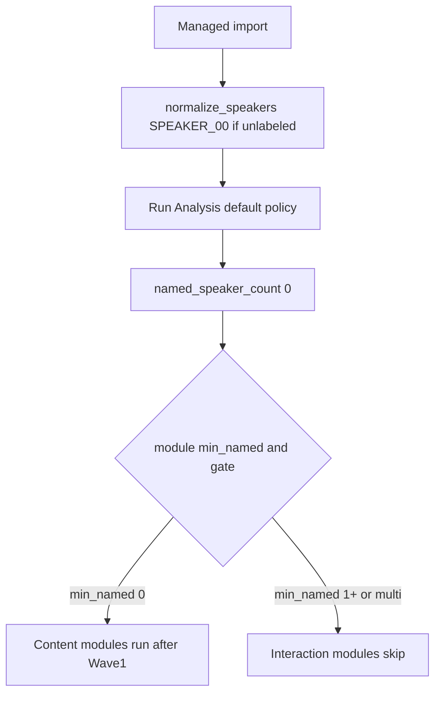

# Plan: Undiarized resilience + ASR plug-in (waves 1–4)

**Canonical implementer doc.** Research: [reports/Open source ASR for TranscriptX.md](../../reports/Open%20source%20ASR%20for%20TranscriptX.md). Product slice: [docs/ROADMAP.md](../../docs/ROADMAP.md) § Next.

**Ship as four PRs.** Each wave: `# backup` → implement → `# light-test` → `# deep-test` → commit → pull/rebase → push → `gh pr create` → merge when CI green → next branch from `main`.

| Wave | Branch | PR title (suggested) |
|------|--------|----------------------|
| 1 | `next/w1-t0-undiarized` | T0 content-only analysis + CocktailASR/noisy-Whisper docs |
| 2 | `next/w2-t1-monologue` | T1 treat-as-single-speaker opt-in |
| 3 | `next/w3-parakeet-theme-k` | Theme K Parakeet/Canary command-gen + WhisperX converter |
| 4 | `next/w4-h5-parakeet-provider` | H5 Parakeet Docker provider + recipe + trust |

---

## Glossary (do not confuse)

| Term | Meaning in this codebase |
|------|---------------------------|
| **T0** | `named_speaker_count == 0` under default policy. Content modules may run; interaction / multi-speaker modules skip with stable reasons. |
| **T1** | User opts in **Treat as single speaker** so modules needing ≥1 speaker use turn-taking count (e.g. import-minted `SPEAKER_00`) without enabling global “allow unnamed” for every meeting. |
| **T2** | **Shipped:** `allow_unnamed_speakers` (global or per-run) — diarized `SPEAKER_00`… count as speakers. |
| **T3** | **Default policy:** human display names via Speaker Identification. |
| **Import mint** | Managed import always runs `normalize_speakers` → unlabeled SRT/VTT becomes **all `SPEAKER_00`** ([speaker_normalizer.py](../../src/transcriptx/io/speaker_normalizer.py)). **Do not remove or gate this in waves 1–4.** |
| **SPEAKER_LABELS requirement** | `TranscriptCapabilities.has_speaker_labels` is true if any segment has a **`speaker` key** (value may be `SPEAKER_00`). This is **not** the same as “named speaker”. |
| **Speaker gate** | `speaker_gate_skip_reason` in [dag_pipeline_run.py](../../src/transcriptx/core/pipeline/dag_pipeline_run.py) uses `effective_min_named_speakers` + named vs turn-taking count. |

### Mental model for implementers



---

## Prerequisites (all waves)

- Python **3.10** venv at repo root: `.venv/bin/python` (see [AGENTS.md](../../AGENTS.md)).
- Run tests from repo root: `.venv/bin/python -m pytest <paths> -q --tb=short`
- **Do not** download NeMo weights, CocktailASR, or run GPU STT in CI or light-test.
- **Do not** register a third `TranscriptionProvider` until Wave 4.
- **Do not** embed STT inside the analysis Docker image.

---

## Wave 1 — T0 content-only path + CocktailASR docs

### Goal (acceptance)

1. With a transcript that has segments but **zero human-named speakers** (e.g. only `SPEAKER_00`), a **quick** run with modules `transcript_quality`, `llm_summary` (if LLM disabled/skipped is OK), `wordclouds` (if deps available) is **not** skipped solely because `named_speaker_count < 1`.
2. Modules with `requires_multiple_speakers: true` still skip when only one turn-taking speaker exists.
3. Charts Overview shows an **info banner** when `named_speaker_count == 0` (not a silent empty page).
4. Docs explain noisy Whisper + CocktailASR BYO path.
5. ROADMAP Next checklist: mark T0 + CocktailASR doc slice done.

### Step 1.1 — Fix the gate floor (required)

**File:** [src/transcriptx/core/pipeline/module_registry.py](../../src/transcriptx/core/pipeline/module_registry.py)

**Current (line ~107–109):**

```python
def effective_min_named_speakers(info: ModuleInfo) -> int:
    return max(info.min_named_speakers, 2 if info.requires_multiple_speakers else 1)
```

**Change to:**

```python
def effective_min_named_speakers(info: ModuleInfo) -> int:
    if info.requires_multiple_speakers:
        return max(info.min_named_speakers, 2)
    return max(info.min_named_speakers, 0)
```

**Add unit test** in [tests/unit/test_speaker_gate.py](../../tests/unit/test_speaker_gate.py):

- `_mod(min_named_speakers=0, requires_multiple_speakers=False)` → `speaker_gate_skip_reason(..., named_speaker_count=0, ...)` returns **`None`** (not skipped).
- `_mod(min_named_speakers=0, requires_multiple_speakers=True)` with `turn_taking_speaker_count=1` → skip reason contains `at least 2`.

### Step 1.2 — Set `min_named_speakers: 0` on content modules

Add `"min_named_speakers": 0` to each module dict below (only these for Wave 1 — do **not** blanket-edit all modules).

| Module ID | Spec file | Notes |
|-----------|-----------|--------|
| `transcript_quality` | [module_specs/core.py](../../src/transcriptx/core/pipeline/module_specs/core.py) | Already `SEGMENTS` only |
| `tics` | core.py | Needed for `insight_eligibility` chain |
| `insight_eligibility` | core.py | **Required** for wordclouds/topics chain |
| `llm_summary` | [module_specs/summary.py](../../src/transcriptx/core/pipeline/module_specs/summary.py) | `requires_llm` — may skip if LLM off; gate must not block on names |
| `llm_custom_qa` | summary.py | Same |
| `topic_modeling` | [module_specs/topics.py](../../src/transcriptx/core/pipeline/module_specs/topics.py) | Heavy; OK to skip on env — not on names |
| `bertopic` | topics.py | Optional extra |
| `wordclouds` | topics.py | Primary T0 proof module |
| `ner`, `names` | module_specs (exports/nlp) | If present with only `SEGMENTS` default |
| `transcript_output` | exports spec | Export-only |
| `highlights`, `summary`, `insights` | summary.py | Global content; set `min_named_speakers: 0` |
| `sentiment`, `keyphrases` | [module_specs/nlp.py](../../src/transcriptx/core/pipeline/module_specs/nlp.py) | Only if module is global; per-speaker sentiment stays gated by module logic |

**Do not change** (keep default `min_named_speakers: 1` or higher): everything under `conversation.py`, `speakers.py` (voice_*), `qa.py` with multi-speaker needs, `stats`/`tics` per-speaker charts if product wants stats to remain name-gated — **optional:** set `stats` to 0 only if tests expect stats in T0; default Wave 1 leaves `stats` at 1 unless product asks otherwise.

**Do not remove** `Requirement.SPEAKER_LABELS` from modules unless you verify `has_speaker_labels` is false for your fixture. For import-minted `SPEAKER_00`, the key exists — requirement passes.

### Step 1.3 — Overview banner

**When:** `named_speaker_count_from_content_loader(loader) == 0`

**Files (pick one primary surface; mirror in blocks if needed):**

- [src/transcriptx/web/page_modules/charts.py](../../src/transcriptx/web/page_modules/charts.py) — before overview slots render (~849+)
- Or [src/transcriptx/web/blocks/implementations/charts.py](../../src/transcriptx/web/blocks/implementations/charts.py)

**Copy (exact or equivalent):**

> No named speakers — showing content-oriented results only. Name speakers in Speaker Identification, enable **Allow unnamed speakers**, or re-transcribe with diarization to unlock interaction charts.

Use `st.info(...)` (Streamlit). Do not throw; do not hide the whole page.

### Step 1.4 — Fixture for tests

Add [tests/fixtures/mini_transcript_speaker00_only.json](../../tests/fixtures/mini_transcript.json) (copy mini, replace all speakers with `SPEAKER_00`, remove human names / speaker_db_id if needed).

Use in pipeline test:

```python
os.environ["TRANSCRIPTX_ALLOW_UNMANAGED_TRANSCRIPTS"] = "1"
modules = ["wordclouds", "transcript_quality"]  # or stats if enabled
# expect modules_will_run includes these; conversation_loops skipped
```

### Step 1.5 — Docs (CocktailASR)

**[docs/runtime/transcription.md](../../docs/runtime/transcription.md)** — insert after “Optional recipes” (or new H3):

**Title:** `When Whisper is noisy or speech overlaps`

**Must include:**

- Multi-speaker meetings: re-run with **WhisperX + `--diarize`** (link [whisperx recipe](../../docs/recipes/whisperx/README.md)).
- Cocktail-party / one voice in noise: BYO **[CocktailASR-1](https://github.com/xiaomi-research/xiaomi-cocktailasr-1)** (Apache-2.0; reference clip + mixture → **one** transcript or empty; **not** multi-speaker JSON; **not** Run-in-app). Import still needs text with timings (adapter or manual segmenting).
- Link [research report](../../reports/Open%20source%20ASR%20for%20TranscriptX.md) and ROADMAP Next.

**[docs/runtime/settings.md](../../docs/runtime/settings.md):** paragraph — default Balanced expects named speakers; T0 content modules run without names; interaction modules skip.

**[docs/comparison-reference.md](../../docs/comparison-reference.md):** one row: CocktailASR-1 | target-speaker ASR | BYO CUDA | not a WhisperX replacement.

**[docs/ROADMAP.md](../../docs/ROADMAP.md):** check off Wave 1 concrete slices.

### Wave 1 — Tests to run

```bash
.venv/bin/python -m pytest tests/unit/test_speaker_gate.py tests/unit/test_dag_gating_named_speakers.py tests/core/utils/test_chart_registry.py -q --tb=short
```

Add `tests/pipeline/test_t0_content_gate.py` (new) if no existing test covers planning skip list.

### Wave 1 — Deep-test

- `analysis_probe_scope = scoped`
- Host Python only:

```python
from pathlib import Path
import os
from transcriptx.app.models.requests import AnalysisRequest
from transcriptx.app.workflows.analysis import run_analysis

os.environ["TRANSCRIPTX_ALLOW_UNMANAGED_TRANSCRIPTS"] = "1"
path = Path("tests/fixtures/mini_transcript_speaker00_only.json")
result = run_analysis(AnalysisRequest(
    transcript_path=path,
    mode="quick",
    modules=["transcript_quality", "wordclouds"],
    run_label="_deep_test_t0",
    allow_unnamed_speakers=False,  # T0 is about named count 0, not T2
))
assert result.success  # or document expected LLM skips
```

- **Do not** pass `modules=None` (pulls in `chart_descriptions` / Ollama).
- Skip Docker §3.2 if daemon unavailable (note in summary).
- Skip large/group probes.

### Wave 1 — Common mistakes

| Mistake | Fix |
|---------|-----|
| Only changing specs, not `effective_min_named_speakers` | Floor still forces min 1 |
| Forgetting `insight_eligibility` / `tics` | `wordclouds` never runs |
| Expecting `allow_unnamed_speakers` for T0 | T0 is **named count 0** with default flag off |
| Adding CocktailASR to `command_gen.py` | Wave 1 is **docs only** |

---

## Wave 2 — T1 `treat_as_single_speaker`

### Goal (acceptance)

1. Per-run checkbox **Treat as single speaker** (default off).
2. When on and `turn_taking_speaker_count >= 1`, speaker gate behaves like `allow_unnamed_speakers=True` for **counting only** (still no multi-speaker modules with one speaker).
3. Persisted on run manifest / `run_results` metadata same as `allow_unnamed_speakers`.
4. CLI flags on `transcriptx analyze` / `analyze_modules` (mirror `--allow-unnamed-speakers`).

### Step 2.1 — Copy the `allow_unnamed_speakers` plumbing (checklist)

Touch **every** file that lists `allow_unnamed_speakers` in grep; add `treat_as_single_speaker` beside it:

| # | File | Action |
|---|------|--------|
| 1 | [app/models/requests.py](../../src/transcriptx/app/models/requests.py) | `AnalysisRequest` + `GroupAnalysisRequest` field `treat_as_single_speaker: bool = False` |
| 2 | [core/config/models/analysis_speakers.py](../../src/transcriptx/core/config/models/analysis_speakers.py) | Pydantic field + description |
| 3 | [core/utils/config/analysis.py](../../src/transcriptx/core/utils/config/analysis.py) | dataclass field `treat_as_single_speaker` |
| 4 | [core/utils/config/env_key_registry.py](../../src/transcriptx/core/utils/config/env_key_registry.py) | `("analysis", "treat_as_single_speaker")` |
| 5 | [core/utils/config/main.py](../../src/transcriptx/core/utils/config/main.py) | export in settings dict |
| 6 | [core/config/gui_support.py](../../src/transcriptx/core/config/gui_support.py) | Settings toggle metadata |
| 7 | [core/pipeline/run_schema.py](../../src/transcriptx/core/pipeline/run_schema.py) | `RunManifestInput` field + `from_cli_kwargs` |
| 8 | [core/pipeline/pipeline.py](../../src/transcriptx/core/pipeline/pipeline.py) | pass into manifest |
| 9 | [app/workflows/analysis.py](../../src/transcriptx/app/workflows/analysis.py) | `RunManifestInput.from_cli_kwargs(..., treat_as_single_speaker=request....)` |
| 10 | [core/pipeline/dag_execution_adapter.py](../../src/transcriptx/core/pipeline/dag_execution_adapter.py) | read runtime flag |
| 11 | [analyze.py](../../src/transcriptx/analyze.py), [analyze_modules.py](../../src/transcriptx/analyze_modules.py), [analyze_backlog.py](../../src/transcriptx/analyze_backlog.py) | CLI `--treat-as-single-speaker` |
| 12 | [web/page_modules/run_analysis.py](../../src/transcriptx/web/page_modules/run_analysis.py) | checkbox + help text |
| 13 | [scripts/generate_pydantic_pilots.py](../../scripts/generate_pydantic_pilots.py) | if analysis speakers pilot lists fields |
| 14 | Golden JSON under `tests/core/config/fixtures/analysis_speakers_*` | add key default false |
| 15 | `tests/core/config/fixtures/delegation_shape_analysis_pre.json` | add key |

### Step 2.2 — Resolve effective ungate

**File:** [core/pipeline/speaker_ungate.py](../../src/transcriptx/core/pipeline/speaker_ungate.py)

Extend API (example):

```python
def resolve_speaker_ungate(
    *,
    per_run_allow_unnamed: bool = False,
    per_run_treat_as_single_speaker: bool = False,
) -> bool:
    if per_run_allow_unnamed or per_run_treat_as_single_speaker:
        return True
    return bool(get_config().analysis.allow_unnamed_speakers)
```

Wire callers that today call `resolve_allow_unnamed_speakers(per_run=...)` to pass both flags.

**Gate logic:** In [dag_pipeline_run.py](../../src/transcriptx/core/pipeline/dag_pipeline_run.py) `speaker_gate_skip_reason`, when `allow_unnamed_speakers` param is true OR treat-as-single is active **and** `turn_taking_speaker_count >= 1`, use turn-taking count (same as today for allow_unnamed).

**Optional global config:** `analysis.treat_as_single_speaker` default false — only per-run is enough for Wave 2 if timeboxed; prefer both for symmetry with allow_unnamed.

### Step 2.3 — Docs

- [settings.md](../../docs/runtime/settings.md): T1 vs T2 table.
- [transcription.md](../../docs/runtime/transcription.md): unlabeled captions → import assigns `SPEAKER_00`; check **Treat as single speaker** on Run Analysis for per-speaker modules without naming.

### Wave 2 — Tests

```bash
.venv/bin/python -m pytest tests/unit/test_speaker_gate.py tests/unit/test_analyze_modules_cli.py -q --tb=short
```

Add test: `treat_as_single_speaker=True`, `named_speaker_count=0`, `turn_taking=1` → `stats` not skipped (if stats min_named still 1, combine Wave 1 stats min_named 0 OR enable treat flag in gate).

**Note:** If `stats` remains `min_named_speakers=1`, T1 must flip gate to turn-taking — **do not** require Wave 1 to change `stats` if T1 is the intended path for per-speaker modules on monologue.

### Wave 2 — Deep-test

```python
run_analysis(AnalysisRequest(
    transcript_path=Path("tests/fixtures/mini_transcript_speaker00_only.json"),
    mode="quick",
    modules=["stats", "sentiment"],
    treat_as_single_speaker=True,
    run_label="_deep_test_t1",
))
```

---

## Wave 3 — Theme K Parakeet + converter (no provider)

### Goal (acceptance)

1. Transcribe Audio **Copy command** lists Parakeet and Canary tools.
2. Generated POSIX + PowerShell snippets are valid shell (no secrets).
3. Converter script: NeMo-like JSONL in → WhisperX-shaped JSON out.
4. Unit tests with golden files; **no** `registry.py` change.

### Step 3.1 — Enum and builders

**File:** [command_gen.py](../../src/transcriptx/services/transcription/command_gen.py)

```python
class TranscriptionTool(str, Enum):
    ...
    NEMO_PARAKEET_DOCKER = "nemo_parakeet_docker"
    NEMO_CANARY_DOCKER = "nemo_canary_docker"
```

Add builders `build_nemo_parakeet_docker` / `build_nemo_canary_docker`:

- Pattern: copy structure from `build_whisperx_docker` in same file.
- Use pinned image (document in recipe stub comment) e.g. `nvcr.io/nvidia/nemo:24.07` or NVIDIA Speech container — **pin one tag in code comment + test snapshot**.
- Mount `input_path`, `output_dir`; emit `docker run --rm` with GPU note `--gpus all`.
- **Darwin honesty:** prepend comment line in `cmd.notes`: `On macOS prefer whispermlx for Run-in-app; Parakeet is CUDA Linux host only.`

Wire `generate_transcription_command` / `generate_transcription_command_powershell` dispatch `if tool is TranscriptionTool.NEMO_PARAKEET_DOCKER`.

### Step 3.2 — Converter

**New file:** `src/transcriptx/services/transcription/nemo_json_to_whisperx.py`

**Input (minimal supported shape — document in module docstring):**

```jsonl
{"start": 0.0, "end": 1.2, "text": "hello world"}
```

Or NeMo manifest lines with `pred_text` / `words` — implement **one** supported format first; second format is follow-up.

**Output (required):**

```json
{
  "segments": [
    {"start": 0.0, "end": 1.2, "text": "hello world"}
  ]
}
```

CLI entry:

```bash
.venv/bin/python -m transcriptx.services.transcription.nemo_json_to_whisperx \
  --input /path/in.jsonl --output /path/originals/meeting.json
```

### Step 3.3 — GUI

**File:** [transcribe_audio.py](../../src/transcriptx/web/page_modules/transcribe_audio.py)

- Add labels to `_TOOL_LABELS` dict for new enum members.
- Add form fields only if needed (model name default `nvidia/parakeet-tdt-0.6b-v3`).
- **Do not** add Run-in-app provider.

### Step 3.4 — Tests

**Extend** [tests/services/transcription/test_command_gen.py](../../tests/services/transcription/test_command_gen.py):

- `test_nemo_parakeet_docker_contains_gpus_and_mounts`
- Snapshot stable substrings (avoid absolute paths).

**New** `tests/services/transcription/test_nemo_json_to_whisperx.py` + fixture `tests/fixtures/transcripts/nemo/sample.jsonl` + expected `tests/fixtures/transcripts/whisperx/from_nemo.json`.

### Step 3.5 — Docs

- [transcription.md](../../docs/runtime/transcription.md): Optional recipes bullet for Parakeet/Canary Copy command + converter step before Import.
- [stt-stacks/README.md](../../docs/recipes/stt-stacks/README.md): Theme K only; not topology A–E yet.
- ROADMAP: check Theme K slice.

### Wave 3 — Deep-test

- `analysis_probe_scope = skipped`
- Full `# tests` + `# pre-release` per command.

---

## Wave 4 — H5 Parakeet Docker provider

### Goal (acceptance)

1. `get_provider("parakeet_docker")` works.
2. Transcribe Audio **Run in app** can select Parakeet when Docker+CUDA checks pass (Linux); Mac still defaults whispermlx.
3. Recipe doc + trust rows + NOTICE attribution.
4. Job writes JSON under output dir; converter runs if raw format is not WhisperX-shaped.

### Step 4.1 — Recipe

Copy layout from [docs/recipes/whisperx/](../../docs/recipes/whisperx/):

- `docs/recipes/parakeet/README.md`
- `parakeet.env.example` (no secrets)
- Optional `docker-compose.parakeet.yml` (reference only)

Document: output → run converter → Import.

### Step 4.2 — Provider class

**New:** `src/transcriptx/services/transcription/parakeet_docker_provider.py`

**Copy pattern from** [whisperx_docker_provider.py](../../src/transcriptx/services/transcription/whisperx_docker_provider.py):

- `_PROVIDER_ID = "parakeet_docker"`
- `_RECIPE_PATH` → parakeet README
- `transcribe()`: `subprocess` `docker run`, discover JSON, optionally call `nemo_json_to_whisperx` if extension `.jsonl`
- `is_available()`: docker binary + daemon; optional CUDA check as **warning** not hard fail on CPU-only hosts

**Register** in [registry.py](../../src/transcriptx/services/transcription/registry.py):

```python
from transcriptx.services.transcription.parakeet_docker_provider import ParakeetDockerProvider
_PROVIDERS[ParakeetDockerProvider.provider_id] = ParakeetDockerProvider()
```

### Step 4.3 — Env / options

**File:** [services/transcription/env.py](../../src/transcriptx/services/transcription/env.py) — allow `TRANSCRIPTX_TRANSCRIPTION_PROVIDER=parakeet_docker` (already on allowlist per CHANGELOG).

**File:** [app/models/requests.py](../../src/transcriptx/app/models/requests.py) `TranscriptionOptions` if `docker_image` override needed.

### Step 4.4 — Trust

- [docs/dev/trust_privacy_model_governance_1_0.md](../../docs/dev/trust_privacy_model_governance_1_0.md): table rows for NeMo Parakeet TDT / Canary (CC-BY-4.0), user-triggered download, optional pyannote note (WhisperX only).
- [NOTICE](../../NOTICE): short STT section with NVIDIA attribution strings from model cards.

### Step 4.5 — Tests

- `tests/services/transcription/test_parakeet_docker_provider.py` — mock `subprocess.run`, mock docker info, assert command list contains `docker` and output path.
- No integration test downloading weights.

### Wave 4 — Deep-test

- `analysis_probe_scope = skipped`
- Live GPU: `skipped (heavy)` unless maintainer machine has CUDA.

---

## CI watchlist (any wave touching modules/config)

When changing `module_specs` or analysis config fields, check [tests/README.md](../../tests/README.md) CI watchlist:

- `registry_ownership_snapshot.json` / delegation goldens if registry ownership changes
- `analysis_speakers_*_golden.json` for new config keys
- Pilot goldens if Pydantic analysis models change

Run when unsure:

```bash
.venv/bin/python -m pytest tests/core/config/test_pydantic_bridge_drift.py tests/core/pipeline/test_registry_ownership.py -q --tb=short
```

---

## Out of scope (all waves)

- CocktailASR provider, Theme K preset, or enrollment UI
- In-process NeMo inside analysis image
- Silent cloud STT; H6 streaming; YouTube ingest
- Default policy remains T3 (named speakers for “full” Balanced UX)
- Opt-in import mint (`normalize_speakers` stays automatic)

---

## Quick reference — key symbols

| Symbol | Location |
|--------|----------|
| `effective_min_named_speakers` | `core/pipeline/module_registry.py` |
| `speaker_gate_skip_reason` | `core/pipeline/dag_pipeline_run.py` |
| `named_speaker_count_for_path` | `core/utils/speaker_extraction.py` |
| `normalize_speakers` | `io/speaker_normalizer.py` |
| `TranscriptionTool` | `services/transcription/command_gen.py` |
| `_PROVIDERS` | `services/transcription/registry.py` |
| WhisperX adapter | `io/import_adapters/json_vendor/whisperx_engine.py` |
