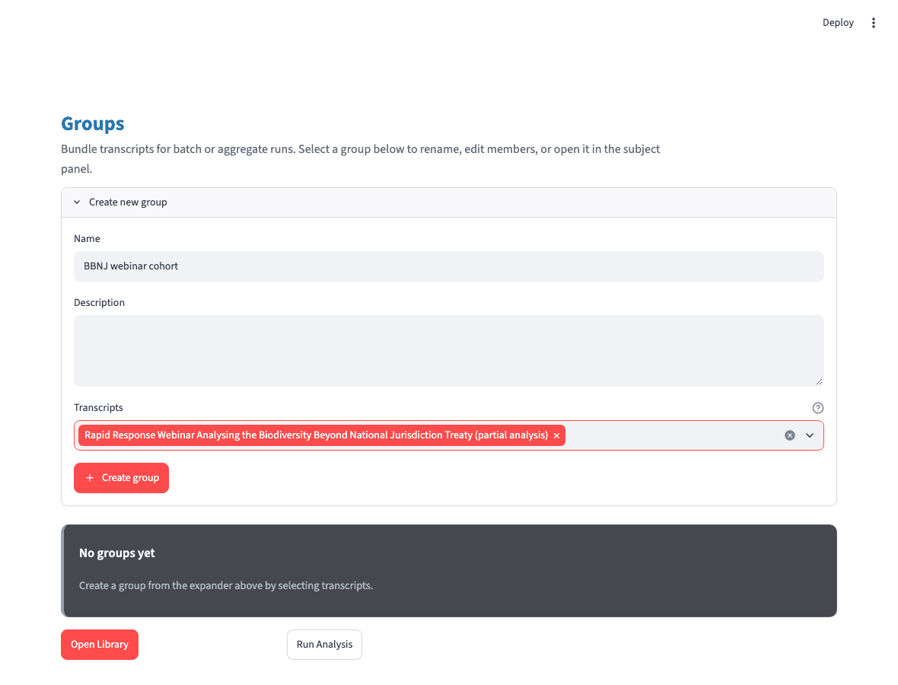
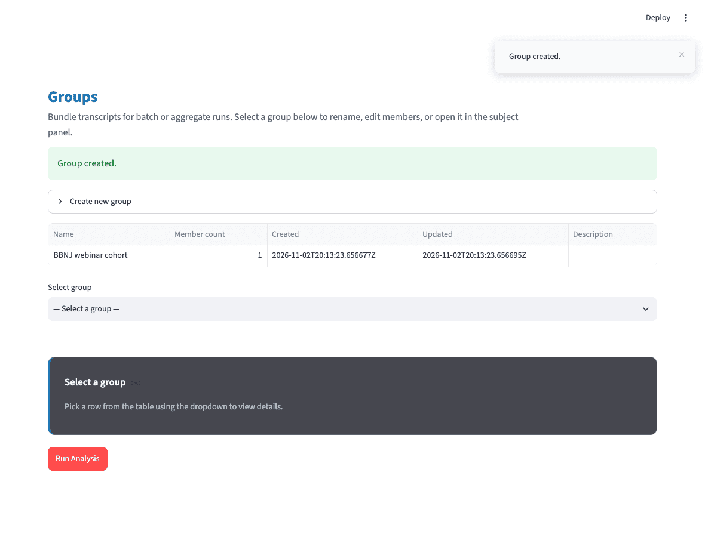
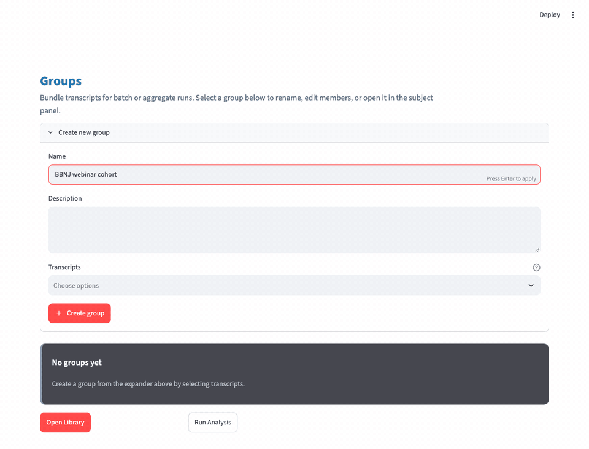

# Bundle transcripts into a group

Create a file-backed **group** so you can analyse related transcripts together and keep membership editable.

## Outcome

You will have created a group that includes the planning-review sample (and optionally other library transcripts), and you will know how to open it for group-targeted analysis.

## Starting point

At least one managed transcript is in the library (see [First analysis](first-analysis.md)). Local AI is not required.

The figures show a group named `BBNJ webinar cohort` being created around the BBNJ webinar transcript; the steps are identical with the planning-review sample.

## What you’ll do

1. Open **Groups**.
2. Create a new group with a clear name.
3. Add the planning-review transcript as a member.
4. Confirm the group appears in the list / picker.
5. Know where to run analysis with a **Group** target.

## Walkthrough

1. Open **Groups** from the sidebar.

2. Expand **Create new group**. Enter a short name (for example `Planning cohort`) and an optional description.

3. In **Transcripts**, select the planning-review entry (and any other members you want). Choose **Create group**.

4. Confirm a success message (`Group created`) or that the group already existed with that membership. The Groups table / **Select group** picker should list the new group.

5. Select the group to review **Group details** (name, member count, membership editor). Membership is file-backed and can be edited later without re-importing transcripts.

6. To analyse the group, open **Run Analysis**, set the target to **Group**, pick this group, and choose a preset. Group analysis availability follows Settings / install profile — see [settings](../runtime/settings.md#analysis-presets) and [installation details](../runtime/installation-advanced.md).

## What to notice

- Groups are membership containers, not a second library. Transcripts stay first-class; the group references them.
- Creating a group does not run analysis by itself — use **Run Analysis** with target **Group**.
- Empty-state copy on Groups points you back to Library when no groups exist yet.
- Archived transcripts are omitted from the member picker. Unarchive from Library, or tick **Include archived transcripts** there first — [Archive a transcript](archive-transcript.md).

## You should now have…

A named group containing the planning-review transcript, ready for group-targeted runs or later membership edits.

## Next

- [First analysis](first-analysis.md) (run again with Group target when enabled)
- [Export a finished analysis](export-results.md)
- [Browse longitudinal speaker profiles](speakers.md)
